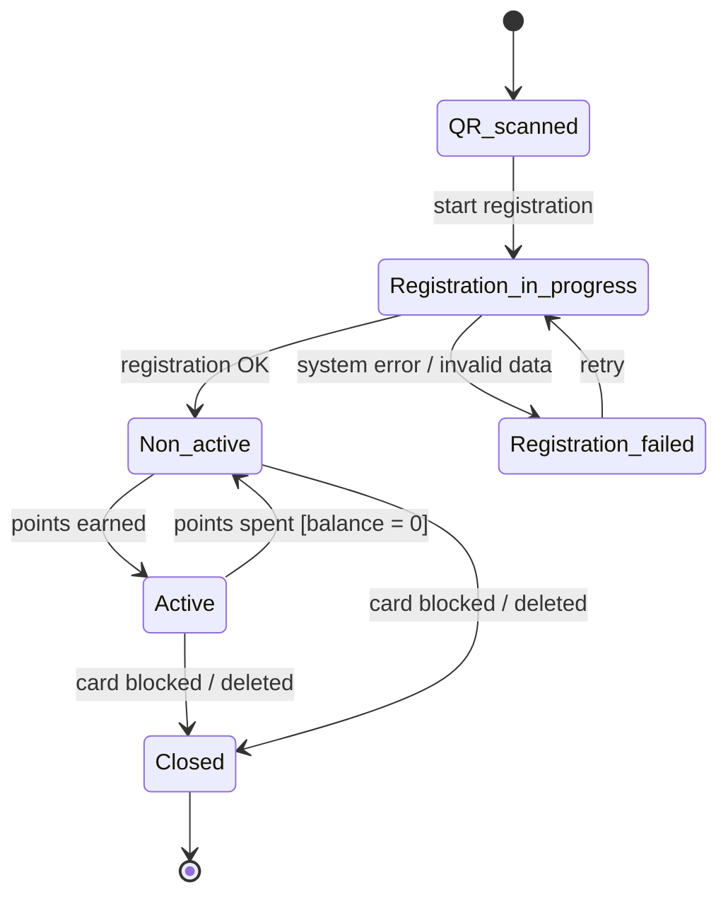

# loyalty-card-diagram
Test design example: State &amp; Transition Diagram for a loyalty card registered via QR code (registration, active/non-active card, failure and closure states).
# Loyalty Card: State & Transition Diagram

This repository contains a test design example built with the **State & Transition Diagram** technique.
It models the lifecycle of a loyalty card (LC) issued to a customer via QR code, and can be used to derive test cases for valid and invalid state transitions.

## States
- **QR scanned**: the customer has scanned the QR code
- **Registration in progress**: the customer data is being processed
- **Registration failed**: the card was not issued (system error or invalid data)
- **Non-active**: the card exists, but the balance is 0 points
- **Active**: the card has points
- **Closed**: the card is blocked or deleted

## Diagram

